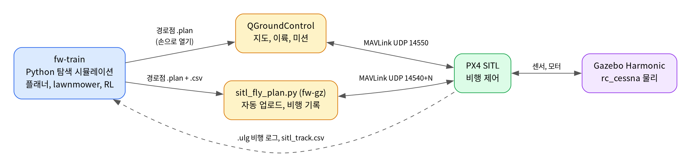
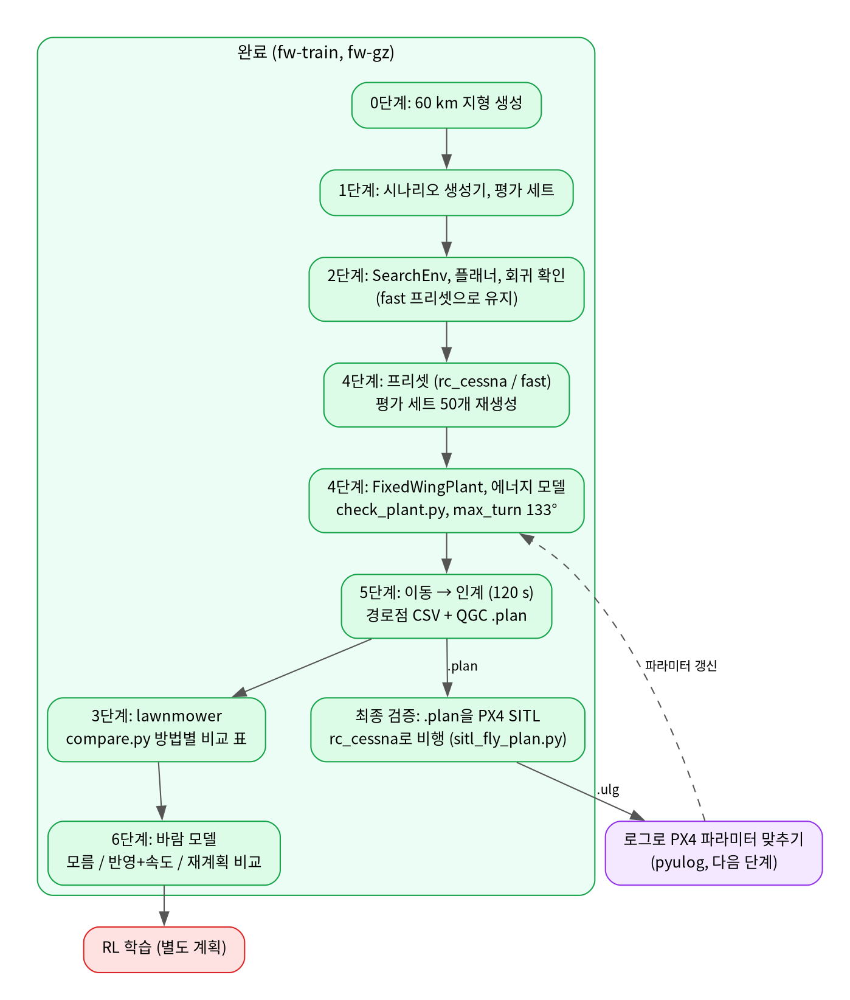
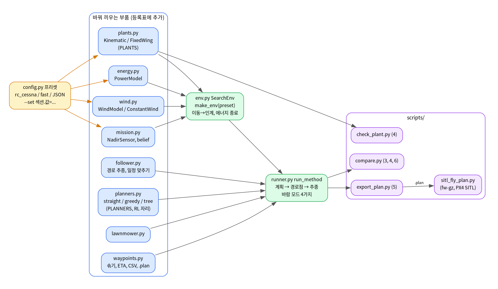
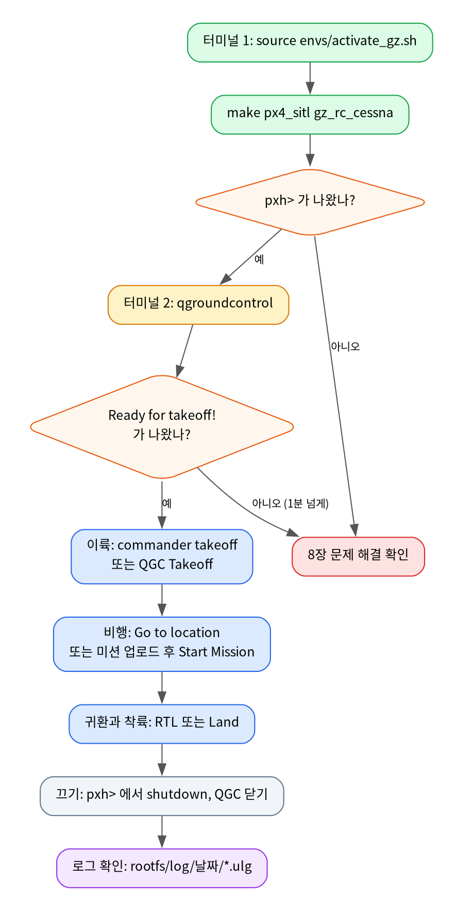

# 입문 가이드: 이 프로젝트의 환경과 사용법

처음 쓰는 사람을 위한 설명서다. 1장은 용어, 2장은 전체 구조, 3장부터는 실제로 따라 하는 순서다. 막히면 8장(문제 해결)을 먼저 본다.

---

## 1. 기본 용어

| 용어 | 뜻 |
|------|----|
| **PX4** | 드론·고정익 비행기에 들어가는 오픈소스 비행 제어 소프트웨어(오토파일럿). 자세 유지, 경로 추종, 이착륙을 한다. |
| **SITL** | Software In The Loop. 실제 비행 컨트롤러 없이 PX4를 PC에서 그대로 돌리는 방식. 센서와 기체는 시뮬레이터가 대신한다. |
| **Gazebo (gz sim)** | 물리 시뮬레이터. 기체의 공기역학, 중력, 바닥을 계산하고 3D 화면을 보여 준다. 여기서는 **Gazebo Harmonic(버전 8)**을 쓴다. |
| **Gazebo Classic** | 예전 Gazebo(버전 11). 이 PC에서는 PX4 플러그인과 충돌해서 쓰지 않는다. |
| **SIH** | Simulation In Hardware. Gazebo 없이 PX4 내부의 간단한 물리 모델로 나는 방식. 화면은 없지만 가장 빠르고 가볍다. |
| **rc_cessna** | Gazebo에 들어 있는 소형 고정익 비행기 모델. 이 프로젝트의 검증 기체다(PLAN 기준). |
| **advanced_plane** | 공기역학을 더 자세히 계산하는 고정익 모델. rc_cessna로 부족할 때 쓰는 대안. |
| **QGroundControl (QGC)** | 지상 관제 프로그램. 지도에서 기체 위치를 보고, 이륙·착륙·경로 비행을 클릭으로 시킨다. |
| **MAVLink** | PX4와 QGC(또는 Python 스크립트)가 주고받는 통신 규약. 시뮬레이션에서는 PC 안에서 UDP로 오간다. |
| **pxh>** | PX4 콘솔 프롬프트. PX4를 실행한 터미널에서 직접 명령을 입력하는 곳. |
| **ulog (.ulg)** | PX4 비행 기록 파일. 롤, 속도, 위치 등 모든 값이 시간순으로 남는다. 나중에 Python 기체 모델 값을 맞출 때 쓴다. |
| **conda 환경** | 프로그램 묶음을 서로 섞이지 않게 나눠 둔 상자. 이 프로젝트는 학습용과 시뮬레이션용 두 상자를 쓴다. |
| **시동(Arm)** | 모터에 전원을 넣는 것. 시동이 걸려야 이륙할 수 있다. 반대는 Disarm. |

---

## 2. 전체 구조



- **학습 쪽(`fw-train`)**: 60 km 지형 위에서 표적 확률(입자)을 만들고, 어떤 경로로 날아야 표적을 찾을 확률(POS)이 높은지 계산한다. RL과 lawnmower(왕복 패턴)를 비교하는 것이 목표다.
- **검증 쪽(`fw-gz`)**: Python에서 정한 경로를 PX4 + Gazebo 기체가 실제로 그렇게 날 수 있는지 확인한다.
- 두 쪽은 파일로 이어진다. Python이 경로점(`.plan`)을 만들어 QGC로 비행시키고, 비행 로그(`.ulg`)를 다시 Python으로 가져와 기체 모델을 맞춘다.

### 연구 전체 흐름

PLAN의 단계가 어떤 순서로 이어지고, 각 단계에서 어느 환경을 쓰는지 보여 준다. 4단계를 3단계보다 먼저 하는 건 PLAN에서 정한 순서다(lawnmower는 기체 선회 한계와 인계 방식을 알아야 설계할 수 있다).



색 구분: 초록은 완료(0~6단계와 PX4 SITL 최종 검증), 보라는 다음 작업(비행 로그로 기체 모델 맞추기), 빨강은 범위 밖(RL 학습, 별도 계획)이다.

### 코드 구조 (모듈)

모든 설정은 **프리셋** 하나에 모여 있고, 기체·에너지·바람·센서·플래너·경로점·경로 추종은 각각 따로 된 파일(부품)이다. 값을 바꿀 때는 코드를 고치지 않고 `--set`으로 바꾸고, 부품을 새로 만들 때는 그 파일의 등록표(`PLANTS`, `PLANNERS`, `METHODS`)에 한 줄 추가하면 된다. 자세한 사용법은 5-2절.



### 시뮬레이션 한 번 돌리는 순서

3장의 내용을 한눈에 본 것이다. 초록은 터미널 1(PX4), 주황은 터미널 2(QGC)에서 하는 일이다.



그림 원본은 `docs/diagrams/*.dot`이다. 고친 뒤에는 다음으로 다시 그린다.

```bash
source ~/fixed_wing_search/envs/activate_train.sh
cd docs/diagrams
for f in *.dot; do dot -Tpng -Gdpi=150 "$f" -o "${f%.dot}.png"; done
```

### 설치된 것과 위치

| 무엇 | 위치 |
|------|------|
| 프로젝트 코드 | `~/fixed_wing_search` |
| PX4 소스와 빌드 | `~/PX4-Autopilot` |
| conda (Miniforge) | `~/.local/miniforge3` |
| QGroundControl v4.4.4 | `~/.local/opt/qgc` (실행 명령: `qgroundcontrol`) |
| git, gh | `~/.local/bin` |
| 환경 켜는 스크립트 | `~/fixed_wing_search/envs/activate_train.sh`, `activate_gz.sh` |
| 비행 로그 | `~/PX4-Autopilot/build/px4_sitl_default/rootfs/log/날짜/*.ulg` |

---

## 3. 시뮬레이션 비행: 처음부터 끝까지

터미널 두 개를 쓴다. **PX4용 터미널**과 **QGC용 터미널**이다.

### 3-1. PX4 + Gazebo 켜기 (터미널 1)

```bash
source ~/fixed_wing_search/envs/activate_gz.sh
make px4_sitl gz_rc_cessna
```

- 첫 줄은 시뮬레이션 환경을 켜고 `~/PX4-Autopilot`으로 이동한다.
- 둘째 줄은 PX4를 실행하고 Gazebo 창을 띄운다. 처음엔 수십 초 걸린다.
- 끝에 `pxh>`가 나오면 PX4가 켜진 것이다.
- 잠시 `Preflight Fail: ...` 경고가 나오는 건 정상이다. 센서와 위치 추정이 안정되는 중이다.
- 화면 없이 돌리려면 `HEADLESS=1 make px4_sitl gz_rc_cessna`.

### 3-2. QGC 켜기 (터미널 2, 새 터미널)

```bash
qgroundcontrol
```

- PX4 터미널에 입력하지 않는다. 그 터미널은 `pxh>` 콘솔이라 일반 명령이 안 먹는다.
- QGC가 자동으로 연결되면 PX4 쪽에 `partner IP: 127.0.0.1`이 찍히고, 지도에 비행기 아이콘이 나온다.
- 조금 지나 PX4 쪽에 **`Ready for takeoff!`**가 나오면 이륙 준비 완료다.

### 3-3. 이륙

둘 중 편한 쪽으로 한다.

- **콘솔에서:** 터미널 1의 `pxh>`에 `commander takeoff`
- **QGC에서:** 왼쪽 **Takeoff** 버튼 → 아래 슬라이더를 오른쪽으로 밀기

고정익은 활주로를 달려 이륙한 뒤, 목표 고도에서 이륙 지점 위를 원을 그리며 돈다(Loiter). 멀티콥터처럼 제자리에 멈출 수 없어서 공중에서는 항상 선회하거나 이동한다.

### 3-4. 날아다니기

- **한 지점으로 보내기:** QGC 지도에서 원하는 곳 클릭 → **Go to location** → 그 위에서 선회한다.
- **고도 바꾸기:** QGC 왼쪽 **Action** → **Change Altitude**.
- **경로점 미션:**
  1. QGC 상단 **Plan**(지도 + 연필 아이콘) 탭으로 간다.
  2. 왼쪽 **Waypoint**를 누르고 지도에 점을 찍는다. 점을 누르면 고도를 바꿀 수 있다.
  3. 위쪽 **Upload**로 기체에 보낸다.
  4. **Fly** 탭으로 돌아와 **Start Mission** 슬라이더를 민다.
- 파일로 된 미션(`.plan`)은 Plan 탭 **File → Open**으로 불러온다. 5단계 `export_plan.py`가 만드는 파일이 이 형식이다(5-3절).

### 3-5. 귀환과 착륙

| 하고 싶은 것 | 콘솔(`pxh>`) | QGC |
|--------------|---------------|-----|
| 이륙 지점으로 복귀 | `commander mode auto:rtl` | 왼쪽 **Return** |
| 착륙 | `commander land` | 왼쪽 **Land** |
| 지금 위치에서 선회 | `commander mode auto:loiter` | 상단 비행 모드 → **Hold** |

착륙하면 잠시 뒤 자동으로 시동이 꺼진다(Disarmed).

### 3-6. 끄기

- 터미널 1: `pxh>`에서 `shutdown` 입력, 안 되면 **Ctrl+C**. Gazebo 창도 같이 꺼진다.
- QGC: 창을 닫는다.

### 3-7. Gazebo 없이 빠르게 (SIH)

화면이 필요 없고 PX4 동작만 보고 싶을 때:

```bash
source ~/fixed_wing_search/envs/activate_gz.sh
make px4_sitl sihsim_airplane
```

QGC 연결과 이륙 방법은 같다. 지도에서만 보인다.

---

## 4. 자주 쓰는 PX4 콘솔 명령

`pxh>`에 입력한다.

| 명령 | 하는 일 |
|------|---------|
| `commander status` | 시동 여부, 비행 모드, 안전 상태 확인 |
| `commander arm` / `commander disarm` | 시동 걸기 / 끄기 |
| `commander takeoff` | 자동 이륙 |
| `commander land` | 착륙 |
| `commander mode auto:rtl` | 이륙 지점 복귀 |
| `commander mode auto:loiter` | 현재 위치 선회 |
| `commander mode auto:mission` | 업로드한 미션 시작 |
| `param show FW_R_LIM` | 파라미터 값 보기 (예: 최대 롤 각도) |
| `param set FW_R_LIM 45` | 파라미터 바꾸기 |
| `listener vehicle_attitude` | 현재 자세 값 한 번 출력 (다른 토픽 이름도 가능) |
| `shutdown` | PX4 종료 |

PLAN 4단계에 나오는 PX4 파라미터(`FW_R_LIM` 롤 한도, `FW_R_TC` 롤 응답 시간, `FW_R_RMAX` 최대 롤 속도, `NPFG_PERIOD` 경로 추종 주기, `FW_AIRSPD_TRIM` 순항 속도)는 `param show`로 실제 값을 확인할 수 있다.

---

## 5. 학습(Python) 환경 사용법

```bash
source ~/fixed_wing_search/envs/activate_train.sh
```

이 명령은 학습용 환경을 켜고 프로젝트 폴더로 이동한다. 그다음 할 수 있는 것:

### 5-1. 단계별 명령

| 단계 | 하는 일 | 명령 | 걸리는 시간 |
|------|---------|------|-------------|
| 0 | 지형 만들기 | `python -m rl_search.scripts.make_terrain` | 이미 만들어 둠. 약 3초 |
| 1, 4 | 평가 시나리오 만들기 | `python -m rl_search.scripts.make_scenarios --preset rc_cessna --n-eval 50 --n-stats 100` | 이미 만들어 둠. 약 13분 |
| 2 | 옛 코드와 결과가 같은지 (회귀) | `python -m rl_search.scripts.check_env` | 약 50초. `fast` 프리셋 시나리오로 한다 |
| 4 | 기체 모델 검증, max_turn | `python -m rl_search.scripts.check_plant` | 약 10초. 그림 3장 |
| 5 | 경로점 내보내기 + 다시 비행 | `python -m rl_search.scripts.export_plan rl_search/data/scenarios/rc_cessna/eval/s1000000 --method greedy` | 1~3분 |
| 3 | 방법별 비교 (POD 1, 0.3) | `python -m rl_search.scripts.compare --n 50` | 약 1시간 (tree가 느림) |
| 4 | 기체 모델별 비교 | `python -m rl_search.scripts.compare --methods greedy tree --tag plants --configs fw:plant.kind=fixed_wing kin:plant.kind=kinematic` | |
| 6 | 바람 세 방식 비교 | `python -m rl_search.scripts.compare --methods greedy lawnmower --tag wind --configs pod0.3: --wind-modes none unaware aware replan` | |
| 보기 | 비행 결과 다시 보기 | `python mission_viewer.py rl_search/data/export/rc_cessna/s1000000` | 그림 창. 저장된 비행을 골라 본다 |

- 결과 파일은 `rl_search/data/` 아래에 생긴다: `plant_check/`(기체 그림), `plans/`(경로점 `.csv`, `.plan`, 요약), `compare/<이름>/`(`table.md` 표와 그림).
- 방법(`--method`, `--methods`): `straight`(직진), `lawnmower`(왕복 패턴), `greedy`(눈앞의 확률만 보고 고름), `tree`(몇 수 앞을 내다봄, 느림).
- 모든 방법은 같은 순서로 돈다: 출발 → LKP로 직진(120 s, 이동 중 계획 계산) → 인계 → 계획을 경로점으로 솎음 → 경로 추종으로 비행. 그래서 실제 PX4에 넘기는 형태와 같다.

### 5-2. 설정 바꾸기 (프리셋)

| 프리셋 | 언제 | 내용 |
|--------|------|------|
| `rc_cessna` (기본) | 4단계부터 | 15 m/s, 결정 4 s, 에너지 60분, POD 0.3, 고정익 모델, 120 s 인계 |
| `fast` | 0~2단계 회귀 확인 | 33.3 m/s, 결정 2 s, 즉시 선회, 에너지 모델 없음 |

값 하나를 바꿀 때는 `--set 섹션.이름=값`을 붙인다. 여러 개를 한 번에 쓸 수 있다.

```bash
python -m rl_search.scripts.check_plant --set plant.FW_R_LIM=45            # 롤 한도 45°로
python -m rl_search.scripts.export_plan <시나리오> --set search.pod=1 handover.t_plan_s=90
python -m rl_search.scripts.compare --configs a:plant.NPFG_PERIOD=10 b:plant.NPFG_PERIOD=14   # 설정끼리 비교
```

| 섹션 | 주요 값 |
|------|---------|
| `plant` | `kind`(fixed_wing / kinematic), `FW_AIRSPD_TRIM`, `FW_R_LIM`, `FW_R_TC`, `FW_R_RMAX`, `NPFG_PERIOD`, `NPFG_DAMPING` (PX4 파라미터 이름 그대로) |
| `search` | `pod`, `dt_s`, `max_turn_deg`(None이면 기체 모델로 자동 측정), `bandwidth_m` |
| `energy` | `enabled`, `induced_share`(선회 항력 비율 k), `budget_s`(비행 시간) |
| `handover` | `enabled`, `t_plan_s`(계획 완성 시각) |
| `export` | `tolerance_m`(솎기 허용 오차), `home_lat/lon`, `altitude_m`, `mission_limit`, `finish`(land / rtl / none) |
| `follow` | `lookahead_m`, `schedule`(도착 시각 맞추기) |
| `lawnmower` | `hdr`(덮을 확률 비율), `lane_spacing_m` |
| `wind` | `speed_mps`(바람 세기 범위), `gust_std_mps`, `replan_error_s` |

시나리오 폴더의 `meta.json`에 그 시나리오를 만든 프리셋이 저장되어 있어서, 시나리오를 넣는 명령은 자동으로 그 설정을 쓴다.

### 5-3. 만든 경로를 PX4로 비행 (최종 검증)

**방법 1: QGC에서 손으로.** 3-1, 3-2처럼 PX4와 QGC를 켠 뒤 Plan 탭 **File → Open**으로 `rl_search/data/plans/rc_cessna/s1000000/greedy_14min/mission.plan`을 열고 **Upload** → Fly 탭 **Start Mission**. 이륙 → 경로점 → 착륙까지 자동이다.

**방법 2: 자동 스크립트.** 화면 없는 PX4를 따로 하나 켜서(지금 켜 둔 PX4와 섞이지 않음) 업로드, 비행, 기록, 비교까지 한다.

```bash
~/fixed_wing_search/envs/run_sitl_headless.sh 1          # PX4 1번(포트 14541), 화면 없음
source ~/.local/miniforge3/etc/profile.d/conda.sh && conda activate fw-gz
cd ~/fixed_wing_search
python rl_search/scripts/sitl_fly_plan.py rl_search/data/plans/rc_cessna/s1000000/greedy_14min/mission.plan --url udpin:0.0.0.0:14541
~/fixed_wing_search/envs/run_sitl_headless.sh stop 1     # 끄기
```

결과는 `.plan` 옆의 `sitl_report.json`(경로에서 벗어난 거리, 도착 시각 차이)과 `sitl_track.csv`(실제 비행 궤적)다. 실제 시간으로 날기 때문에 14분짜리 경로는 15분쯤 걸린다. 1시간 전체 경로는 경로점이 500개를 넘어 실기체 한도를 넘으므로(내보낼 때 경고가 나옴) 짧게 잘라(`--max-minutes`) 확인한다.

### 5-4. 비행 로그 열어 보기 (pyulog)

```bash
source ~/fixed_wing_search/envs/activate_train.sh
ulog_info ~/PX4-Autopilot/build/px4_sitl_default/rootfs/log/<날짜>/<파일>.ulg      # 요약
ulog2csv  ~/PX4-Autopilot/build/px4_sitl_default/rootfs/log/<날짜>/<파일>.ulg -o /tmp/ulog_csv   # 토픽별 CSV
```

`vehicle_attitude`(자세), `vehicle_local_position`(위치), `vehicle_attitude_setpoint`(목표 롤) CSV를 열면 선회할 때 롤이 어떻게 움직였는지 볼 수 있다.

---

## 6. GitHub 작업

GitHub 계정(`21seok95`)이 연결되어 있다.

```bash
cd ~/fixed_wing_search
git pull                      # 최신 내용 받기
git status                    # 바뀐 파일 보기
git add <파일>                 # 올릴 파일 고르기
git commit -m "설명"           # 기록 남기기
git push                      # GitHub에 올리기
```

`ENV_SETUP.md`, `GUIDE_KO.md`, `envs/`, `docs/`, 4~6단계 코드(`rl_search/config.py` 등) 같은 이번에 만든 파일은 아직 GitHub에 올리지 않았다. `git status`로 목록을 보고 올린다. `rl_search/data/`(생성물)는 `.gitignore`로 빠진다.

---

## 7. 꼭 지킬 것

- **PX4는 터미널에서 직접 실행한다.** 입력할 터미널 없이 백그라운드로 돌리면 `pxh>`가 끝없이 찍혀서 로그 파일이 몇 GB로 커진다. 꼭 백그라운드로 돌려야 하면 다음처럼 한다.
  ```bash
  tail -f /dev/null | HEADLESS=1 make px4_sitl gz_rc_cessna > /tmp/px4.log 2>&1 &
  ```
- **PX4는 같은 번호로 한 번에 하나만 켠다.** 이미 켜져 있으면 새로 켤 때 `PX4 server already running for instance 0`으로 실패한다. 자동 검증용은 `envs/run_sitl_headless.sh 1`(1번, 따로 된 Gazebo)이라 0번과 같이 켜도 된다.
- **PX4 빌드는 `activate_gz.sh`를 켠 상태에서만 한다.** 예전 `activate_sim.sh`(Gazebo Classic)는 이제 자동으로 `activate_gz.sh`로 넘어간다.
- **QGC는 아무 터미널에서나 `qgroundcontrol`로 켠다.** AppImage 파일을 직접 실행하면 conda 라이브러리와 충돌할 수 있다.

---

## 8. 문제 해결

| 증상 | 원인과 해결 |
|------|-------------|
| `PX4 server already running for instance 0` | PX4가 이미 켜져 있다. 켜진 터미널에서 `shutdown` 또는 Ctrl+C. 어디서 켜졌는지 모르면 `pkill -f bin/px4` 후 `rm -f /tmp/px4_lock-0 /tmp/px4-sock-0`. |
| `Preflight Fail: ...`가 계속 나옴 | 시작 직후엔 정상이다. 1분 넘게 `No connection to the ground control station`이 나오면 QGC를 켠다. |
| QGC에 기체가 안 보임 | PX4가 먼저 켜져 있는지 확인. QGC 첫 실행 때 뜨는 설정 창을 닫아야 연결을 시작한다. |
| QGC 시작 시 `dialout`, `modemmanager` 안내 | USB 실기체용 권한 안내다. 시뮬레이션에서는 무시해도 된다. 실기체를 쓸 땐 `sudo usermod -a -G dialout $USER`, `sudo apt-get remove modemmanager -y` 후 다시 로그인. |
| `pxh>`에 쓴 명령이 `command not found` | PX4 콘솔이라 일반 리눅스 명령(`qgroundcontrol`, `ls` 등)은 안 된다. 새 터미널을 연다. |
| `make`가 `CMake Error`나 protobuf 오류로 실패 | 다른 환경이 섞였다. 새 터미널을 열고 `source ~/fixed_wing_search/envs/activate_gz.sh`부터 다시. |
| 디스크가 갑자기 참 | `/tmp`의 큰 로그 확인: `ls -lh /tmp/*.log`. 7장의 백그라운드 실행 주의 참고. |
| 최신 QGC를 받으면 실행이 안 됨 | QGC 5.x는 Ubuntu 24.04용이라 이 PC(22.04)에서 안 된다. 설치된 v4.4.4를 쓴다. |
| `Mission rejected: Landing waypoint/pattern required` | PX4 고정익은 미션 끝에 착륙이 있어야 한다(`MIS_TKO_LAND_REQ 2`). `export_plan.py`는 기본으로 착륙 패턴을 붙인다(`export.finish=land`). 직접 만든 미션이면 QGC에서 **Pattern → Fixed Wing Landing**을 추가한다. |
| `Holding at … m above landing waypoint` | 착륙이 중단된 것이다. `gz_rc_cessna`에는 거리 센서가 없어서, 기본 `FW_LND_ABORT 3`이면 지형 추정이 안 되어 멈춘다. `sitl_fly_plan.py`는 이 인스턴스에서만 `FW_LND_ABORT 0`, `FW_LND_USETER 0`으로 바꾼다. |
| `Arming denied: Resolve system health failures first` | 시동 거부 이유는 PX4 로그에 있다. 자동 검증용은 `~/PX4-Autopilot/build/px4_sitl_default/instance_1/px4.log`의 `Preflight Fail` 줄을 본다. 시작 직후 `Yaw estimate error`는 잠시 뒤 사라진다. |
| `mission items exceed the limit 500` 경고 | 경로점이 실기체 미션 한도를 넘었다. `--set export.tolerance_m=30`으로 더 솎거나 `--max-minutes`로 나눈다. |
| 비행기가 공중에서 이상한 상태(고도가 음수 등) | 이전 비행에서 추락한 상태다. PX4를 껐다 다시 켠다(`shutdown` 후 `make px4_sitl gz_rc_cessna`). |

---

## 9. 더 보기

- 환경 구성의 기술적인 세부 사항: [ENV_SETUP.md](ENV_SETUP.md)
- 연구 계획과 단계별 할 일: [rl_search/PLAN.md](rl_search/PLAN.md)
- 학습 코드 실행 순서: [rl_search/README.md](rl_search/README.md)
- PX4 공식 문서(고정익): https://docs.px4.io/main/en/frames_plane/
- QGC 사용자 가이드: https://docs.qgroundcontrol.com/master/en/qgc-user-guide/
