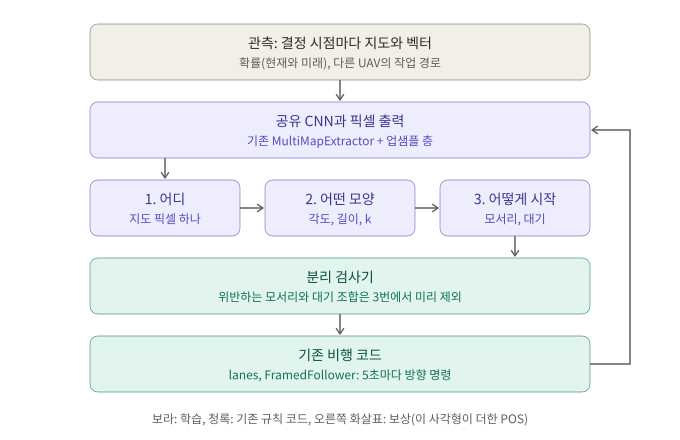

# 사각형 단위 RL 논의 (2026-11-04, Ubuntu 세션 답변 원문)

**상태:** 논의 중이다. 합의 전이고 구현한 것은 없다.

이 문서는 답변을 그대로 옮긴 것이다. 본문 내용은 고치지 않았고, 달라진 점은 세 가지다.

- 대화창에 그린 구조 그림을 파일로 넣었다.
- 저장소 안 링크를 이 문서 위치 기준으로 바꿨다.
- "복사 시 추가"로 표시한 안내를 덧붙였다.

## 질문

> 다음 내용 진행전에 궁금한 점이 있어서 질문을 해. 많이 고민해보고 자료도 찾아보고 근거있는 답을 해주면 좋겠어
>
> 지금 분리 제약, 즉 충돌회피를 위한 SAROPS 다수 UAV를 최적화로 구현해 뒀는데, 이러한 행동을 강화학습으로 구현하려면?(깃헙에 있는 rl 환경/Observation/ 모델 구조를 최대한 활용) 즉 1) 이동시에는 특정 지점까지 이동, 2) 이동 후, 탐색할 사각형의 시작 좌표, 시작 방향, 시작 좌표의 대각선 끝 좌표, 사각형의 각도 등의 행동을 동시에 결정하거나 계층적인 구조로 되어 있는 모델
>
> 구현해달라는건 아니고 아이디어나 의견 등을 공유해보자.

## 답변

**결론:** 5초마다 방향을 고르는 지금 구조 대신, **사각형(작업)을 고르는 RL, 기존 비행 코드, 분리 검사기를 쌓는 3층 구조**를 추천합니다. 동시 결정과 계층 중에서는 항목별로 나눠서 답합니다.

- **시간은 계층으로 나눕니다.** RL은 작업이 끝날 때만 결정합니다. 1대 기준 에피소드당 결정이 695번에서 약 5번으로 줄어듭니다.
- **학습하는 층은 맨 위 하나만 둡니다.** 레인 추종은 이미 있는 규칙 코드가 정확하게 하므로, 하위 RL을 두면 학습량만 늘어납니다.
- **사각형 변수는 순서대로 고릅니다.** 어디, 어떤 모양, 어떻게 시작의 순서입니다.

다만 RL이 SAROPS를 크게 넘을 여지는 작게 측정됐습니다. 구조는 아래 그림과 같습니다.



## 1. 측정 결과

RL을 학습하지 않고, 정해진 규칙과 무작위 선택으로 비행시켜 쟀습니다. 시나리오 300~329에서 새 particle로 잰 POS입니다. 저장소 코드는 바꾸지 않았습니다.

| 1대 정책 | POS | 에피소드당 계산 |
|---|---:|---:|
| 5초마다 무작위 회전 | 0.017 | 0.4초 |
| 사각형, 위치까지 무작위 | 0.016 | 0.5초 |
| 5초 RL (200만 스텝 학습) | 0.080 | – |
| 위치만 확률 분포에서 뽑고 모양은 무작위 | 0.226 | 0.7초 |
| 위치는 확률 분포, 모양은 아코디언 | 0.297 | 1.0초 |
| 봉우리 사각형 중 시뮬레이션 1위 | 0.384 | 3.8초 |
| SAROPS 작업 단위 | 0.402 | 50초 |
| 후보 약 12개를 에피소드 끝까지 날려 보고 고르기 | 0.407 | 76초 |
| SAROPS 10분 고정 | 0.439 | 47초 |

- **가장 큰 값은 "어디"에서 나옵니다.** 사각형을 쓰는 것만으로는 소용없고(0.016), 위치를 확률에 맞추면 0.226으로 오릅니다. 6시간 학습한 5초 RL의 약 3배입니다.
- **앞을 내다보는 이득은 작습니다.** 끝까지 날려 보고 골라도 SAROPS 작업 단위보다 +0.005 ± 0.004입니다. 탐색 범위를 제한한 값이라 하한이고, 5대에서의 여지는 아직 재지 않았습니다.
- **구조 차이가 더 큽니다.** 10분 고정이 작업 단위보다 +0.037 높습니다(30개 중 27개). 원인은 아직 모릅니다.

이 값들은 실제 RL이 여기까지 간다는 증거가 아니라, 출발점과 넘어야 할 선입니다.

## 2. RL이 출력할 값

말씀하신 변수는 일부가 겹칩니다. 시작 좌표, 대각선 끝, 각도만으로 사각형이 정해집니다. 지금 코드에서는 첫 레인이 각도 방향이라 시작 방향도 따로 고를 값이 아닙니다. 탐색 시간을 10분으로 고정하면 폭도 길이에서 계산됩니다.

| 말씀하신 값 | RL이 고를 값 |
|---|---|
| 시작 좌표, 대각선 끝 | 중심 픽셀(`wide` 지도 64×64, 칸당 400 m), 길이 구간, 덮는 횟수 k(1~3) |
| 사각형 각도, 시작 방향 | 각도 12구간(15° 간격) |
| 시작 좌표가 어느 모서리인지 | 모서리 4개 중 1개 |
| 이동 | 없음. 시작 모서리까지 자동으로 비행 |
| 추가: 대기 | 0, 1, 2, 3, 5분 중 1개 |

- **좌표 두 개를 따로 내지 않습니다.** 각자 출력하면 10분에 맞지 않는 사각형이 쉽게 나옵니다.
- **위치는 연속값 대신 지도 픽셀로 고릅니다.** 제 추론으로는 x, y 연속값이면 봉우리가 둘일 때 평균이 그 사이로 갑니다. [Spatial Action Maps](https://arxiv.org/abs/2004.09141)에서는 픽셀을 목적지로 삼은 방식이 6만 전이로 학습했고, 조향 명령 방식은 잘 배우지 못했습니다. 다만 DQN 기반 연구입니다.
- **각도와 길이는 픽셀마다 출력하고, 고른 픽셀의 값을 읽습니다.** [CenterNet](https://arxiv.org/abs/1904.07850)의 중심 히트맵 방식, [H-PPO](https://arxiv.org/abs/1903.01344)의 행동별 파라미터와 같은 형태입니다. 순서대로 고르는 구조는 [AlphaStar](https://storage.googleapis.com/deepmind-media/research/alphastar/AlphaStar_unformatted.pdf)에도 있습니다.
- **값은 구간으로 나눕니다.** PPO에서 이산화가 성능을 높였다는 [보고](https://arxiv.org/abs/1901.10500)가 있습니다. 예전 시험(시나리오 8개)에서도 회전과 모서리의 기여는 약 0.005로 작았습니다.
- **이동을 별도 행동으로 두지 않습니다.** 위치-확률 정책 측정(시나리오 8개)에서 규칙 접근 비행은 전체의 약 3%뿐이었습니다.
- **처음부터 0.226에서 출발할 수 있습니다.** 위치 출력에 미래 확률 지도의 로그값을 더해 두고, 신경망은 보정만 배우게 합니다([Residual Policy Learning](https://arxiv.org/abs/1812.06298)과 같은 발상). 지난 학습의 "분포 안 36%" 문제를 출발점에서 없앨 수 있습니다.

## 3. 기존 코드 활용

**그대로 쓰는 것**
- [`RLSearchEnv`](../rl_search/rl_env.py#L71)의 비행, 탐지, 에너지, 지오펜스
- RL 연결점인 [`AccordionPlanner.choose`](../rl_search/accordion.py#L552). 이번 측정 정책도 대부분 이 함수만 바꿔 만들었습니다.
- [`run_team_launch`](../rl_search/multi.py#L115), [`future_factor`](../rl_search/multi.py#L63), [`conflict_seconds`](../rl_search/accordion.py#L445), `compare_multi`. SAROPS와 같은 표로 바로 비교할 수 있습니다.
- [`MultiMapExtractor`](../rl_search/rl_gym.py#L51). 입력 채널 수는 자동으로 맞춰집니다.

**바꾸는 것**
- **결정 시점:** 5초가 아니라 [`due`](../rl_search/multi.py#L53)일 때입니다. `run_team_launch`가 결정마다 멈추도록 고쳐야 합니다.
- **관측:** 미래 확률 채널(+5, +10, +15, +20분)을 넣습니다. 표적이 15분에 약 4~7 km 움직여서, 지금 분포만으로는 10분짜리 약속을 정하기 어렵습니다.
- **채널 0:** `w_area=0`이면 미탐색 영역 채널이 필요 없으니 다른 UAV 경로로 바꿉니다. 그러면 [보상 구역 계산](../rl_search/rl_env.py#L385)도 뺄 수 있습니다. 관측 1회 기준 이 계산을 포함하면 40~140 ms, 빼면 5~7 ms입니다.
- **신경망:** [`Flatten`](../rl_search/rl_gym.py#L64)이 위치 정보를 없애므로, `wide` 지도에 작은 업샘플 층을 붙여 픽셀 출력을 만듭니다.
- **정책 분포:** 순서대로 뽑는 분포를 직접 구현해야 합니다. `MaskablePPO`는 MultiDiscrete까지만 지원하고, 지금 환경에 설치돼 있지도 않습니다.
- **시나리오:** 생성에 16초가 걸리니 미리 만들어 둡니다. 불러오기는 3 ms, 개당 17 MB입니다. 그러면 1대는 시간당 약 2만 에피소드까지 가능합니다(신경망 계산 제외 추정). 지난 학습은 6시간에 2,880개였습니다.

## 4. 다수 UAV와 충돌 회피

- **정책 하나를 공유하고, 작업을 끝낸 UAV 차례로 결정합니다.** [ScheduleNet](https://arxiv.org/abs/2106.03051)과 같은 이벤트 방식이고, 지금 SAROPS의 순차 계획과도 맞습니다. 전체 공동 결정은 [Mac-CAC](https://arxiv.org/abs/2209.10113)에서 국소해에 갇혔고, 같은 종류 에이전트의 신경망 공유는 [MAPPO](https://arxiv.org/abs/2103.01955)에서 효율이 좋았습니다.
- **보상은 "이 사각형이 더한 POS"로 둡니다.** 이 값의 합이 팀 POS와 맞는지 쟀더니, 시나리오 8개의 1대·5대에서 최대 차이가 0.003이었습니다. 팀 목표를 유지하면서 UAV별 기여를 나눌 수 있습니다. [Xiao 등](https://arxiv.org/abs/2209.10113)도 자기 행동에 묶인 보상이 분산을 줄인다고 보고했습니다.
- **다른 UAV 경로를 시간대별 지도 채널로 줍니다.** [Spatial Intention Maps](https://arxiv.org/abs/2103.12710)에서 상대의 의도를 지도로 주자 성과가 19.00 대 11.89, 19.57 대 13.96으로 올랐습니다. 다른 과제의 수치입니다.
- **안전은 학습에 맡기지 않습니다.** 벌점만으로는 보장이 없으므로, 위치와 모양을 고른 뒤 위반되는 모서리·대기 조합을 선택지에서 뺍니다. 이 방식(마스크)은 [학습 수식을 깨지 않습니다](https://arxiv.org/abs/2006.14171). 반대로 행동을 바꿔치기해 저장하면 [PPO에 특히 해롭습니다](https://arxiv.org/abs/2205.06750). [다중 에이전트 shielding 연구](https://arxiv.org/abs/2101.11196)도 안전장치가 성능을 해치지 않았다고 보고합니다.

5대에서 지금 검사기를 단순한 정책에 붙여 봤습니다.

| 제안 정책 | 검사기 | POS | 300 m 안 시간 | 최근접 | 해 없는 계획 |
|---|---|---:|---:|---:|---:|
| 확률 위치 + 무작위 모양 | 없음 | 0.573 | 339초 | 6 m | – |
| 확률 위치 + 무작위 모양 | 있음 | 0.567 | 114초 | 7 m | 90 |
| 확률 위치 + 아코디언 | 없음 | 0.627 | 352초 | 4 m | – |
| 확률 위치 + 아코디언 | 있음 | 0.619 | 206초 | 1 m | 75 |
| SAROPS | 있음 | 0.676 | 246초 | 0 m | 69 |

검사기는 어떤 정책에 붙여도 근접 시간을 41~66% 줄이고, POS 손해는 0.008 이하입니다. 하지만 정책이 달라도 최근접은 여전히 0 m 근처입니다. 빈틈이 최적화보다 검사 쪽에 있다는 의심이 커졌고, RL의 안전도 이 검사기 수준을 넘지 못합니다.

## 5. 실험 순서 제안

1. **분리 검사 빈틈을 먼저 진단합니다.** 원래 다음 할 일이고, 아래 4번의 전제입니다.
2. **1대, 위치만 학습:** 모양은 아코디언에 맡깁니다. 출발 0.297, 넘을 선은 0.384와 0.402입니다.
3. **1대, 모양까지 학습:** 출발 0.226, 넘을 선은 2번 결과입니다.
4. **2대, 5대로 확장:** 경로 채널과 마스크를 넣고, SAROPS의 0.676, 246초와 비교합니다.

2번과 3번은 1대라서 1번과 병행할 수 있습니다. 선을 못 넘으면 다음 단계로 가지 않습니다. 2번이 막히면 봉우리 후보 K개 중 고르기로 낮춰 점검하고, 그다음 수단으로 SAROPS 모방 학습을 씁니다. 다만 모방으로 시작한 정책을 그대로 이어 학습하면 [잘 안 되는 경우가 많다](https://arxiv.org/abs/2204.02372)는 보고가 있습니다.

## 6. 걱정되는 점

- **RL을 쓰는 목적이 가장 큰 문제입니다.** 새 정보가 없는 지금 설정에서는 계획 1회 약 10초가 10분 작업에 부담이 되지 않고, 내다보는 이득도 작습니다. RL이 이득을 볼 만한 곳은 비행 중 표적 정보 갱신, UAV 고장, 모델 불일치입니다. [11월 3일 문서 결론](sarops_approach_todo.md#L408)과 같은 방향이고, 구역 선택 RL은 [S.6](sarops_approach_todo.md#L759)에서 보류했으니 이번에 다시 여는 셈입니다.
- **지도가 하나뿐입니다.** 절대 좌표와 `global` 지도로 지형을 외울 수 있어서, 일반화를 말하려면 지형 2~3개로 학습해야 합니다.
- **이 구조를 그대로 쓴 선행 연구는 못 찾았습니다.** 가장 가까운 것은 [상위 목표 구역 + 하위 조향 구조](https://www.citedrive.com/en/discovery/a-high--and-low-level-decoupled-reinforcement-learning-method-for-multi-uav-cooperative-search/)인데 정지 표적과 2차원 격자 환경입니다. 연구 기여가 될 수 있지만, 조사 범위가 넓지 않아 단정하지는 않겠습니다.

## 의논하고 싶은 것

1. **RL의 목표를 무엇으로 둘까요?** 저는 최종 목표를 "새 정보가 들어오는 상황에서 SAROPS보다 낫게"로 두고, "SAROPS 수준을 즉시 내기"를 중간 검증으로 쓰는 쪽을 추천합니다.
2. **결정 시점은 언제로 할까요?** 레인 완료(0.402)와 10분 고정(0.439) 중 하나를 골라야 합니다. 저는 차이의 원인을 먼저 확인하고 정하는 쪽을 추천합니다.

측정 코드는 `/tmp/claude-1000/-home-lee-fixed-wing-search/34bef2b3-4d32-4393-8b01-a7554e21ec72/scratchpad/macro/`에만 있습니다. 맥에서도 보시려면 문서로 정리해 깃헙에 올리겠습니다.

**Sources:** 위 본문의 링크 외에, 항공 분리에 PPO와 공유 신경망을 쓴 사례로 [Brittain 등](https://arxiv.org/abs/2003.08353), 이 문제를 "반복 최적화를 미리 학습해 두는 것"으로 보는 관점으로 [Amos의 튜토리얼](https://arxiv.org/abs/2202.00665), 계층의 이득이 주로 탐험에서 온다는 [Nachum 등](https://arxiv.org/abs/1909.10618)을 참고했습니다.

---

## 복사 시 추가: 측정 코드와 원자료

위 답변의 "임시 폴더에만 있다"는 문장은 답변 당시 기준이다. 지금은 아래 위치에 있다.

- 측정 코드: [`rl_search/scripts/rect_rl_probe/`](../rl_search/scripts/rect_rl_probe/)
- 원자료와 로그: `rl_search/data/rect_rl_probe/`
- 비교에 쓴 기존 결과: `rl_search/data/compare_multi_sarops/results.json`(SAROPS 작업 단위, 5대), `rl_search/data/compare_greedy/results.json`(SAROPS 10분 고정), `rl_search/data/rl/stage3_pos/analysis/`(5초 RL)

표의 수치 다시 출력하기:

```bash
PYTHONPATH=. python rl_search/scripts/rect_rl_probe/summarize.py
```

측정 다시 돌리기(저장소 루트에서, 터레인 파일 필요, 6 워커 기준 1대 8분, 5대 22분, 끝까지 비행 탐색 11분):

```bash
PYTHONPATH=. python rl_search/scripts/rect_rl_probe/probe.py --output rl_search/data/rect_rl_probe/ladder.json
```

```bash
PYTHONPATH=. python rl_search/scripts/rect_rl_probe/team.py --output rl_search/data/rect_rl_probe/team.json
```

```bash
PYTHONPATH=. python rl_search/scripts/rect_rl_probe/rollout.py --output rl_search/data/rect_rl_probe/rollout.json
```

```bash
PYTHONPATH=. python rl_search/scripts/rect_rl_probe/marginal.py rl_search/data/rect_rl_probe/marginal.json
```

| 코드 | 내용 | 표에서 쓴 곳 |
|---|---|---|
| `probe.py` | 1대 정책 단계별 POS | 1번 표 |
| `rollout.py` | 후보 약 12개를 끝까지 날려 보고 고르기 | 1번 표 0.407 |
| `team.py` | 5대, 검사기 유무 | 4번 표 |
| `marginal.py` | 결정별 POS 증가량의 합과 팀 POS 비교, 규칙 접근 비행 비율 | 4번 첫 부분, 2번 "약 3%" |
| `timing.py`, `timing2.py` | 부품별 계산 시간 | 3번 |
| `summarize.py` | 위 결과를 표로 출력 | 전체 |

3번의 "40~140 ms, 5~7 ms"와 "3 ms"는 다른 측정이 함께 돌 때 잰 값이다. 다른 작업 없이 다시 잰 값은 `rl_search/data/rect_rl_probe/timing.txt`에 있고, 관측 1회가 보상 구역 계산을 포함하면 30~50 ms, 빼면 약 4 ms, 시나리오 불러오기는 1 ms 미만이다.

모두 탐색용 코드다. 정식 스크립트나 테스트로 정리한 것이 아니고, 학습 코드도 들어 있지 않다.
