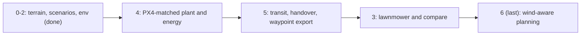
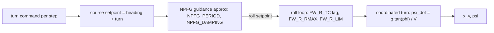
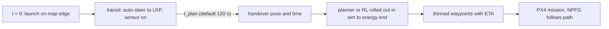

# RL vs Lawnmower: 단계별 계획

## 목표

같은 배터리(에너지) 조건에서 RL이 고른 heading으로 비행하면 lawnmower 같은 고정 패턴보다 누적 POS가 높아질 수 있음을 보인다. 검증은 PX4 + Gazebo와 실기체에서 하므로, Python 모델은 PX4 고정익 제어 구조와 Gazebo 기체에 최대한 맞춘다. 실제 운용에서는 UAV가 LKP로 이동하는 동안 계획을 완성하고, 완성된 계획(경로점 목록)을 PX4에 넘겨 그대로 비행한다.

## 진행 순서



4단계를 3단계보다 먼저 한다. lawnmower는 기체의 선회 한계와 인계 방식 위에서 설계해야 하므로, 고정익 모델과 인계 구조가 먼저 있어야 한다.

## 확정한 결정

- **기존 파일:** 루트의 기존 파일은 참고용으로 그대로 둔다. 바꿀 부분은 `rl_search/`로 fork해서 수정하고, 수정 후 기존 플래너 결과와 비교한다.
- **맵과 시간:** seed 7로 만든 60 km × 60 km 절차적 지형 하나를 고정한다. t = 0은 LKP 관측 시각이면서 UAV 출발 시각이다.
- **검증 기체:** PX4 Gazebo `gz_rc_cessna`를 기준으로 한다. 공력까지 맞출 필요가 생기면 `gz_advanced_plane`(PX4 v1.15+)으로 바꾼다.
- **UAV (4단계부터):** 순항 15 m/s(`FW_AIRSPD_TRIM` 기본값). 속도는 설정값이라 33.3 m/s(120 km/h)도 그대로 쓸 수 있다. 결정 간격 4 s(한 스텝 60 m, footprint 길이 83 m보다 짧음). 비행 예산은 에너지로 정의하고 기준은 순항 60분이다.
- **행동:** 결정 간격당 heading 변화량(turn)이다. 롤은 기체 모델 내부 상태이고, 4단계부터 관측에 넣는다.
- **PX4 명령 방식:** NPFG 경로 추종에 맡긴다. 고도와 속도는 PX4(TECS)가 유지한다. 운용에서는 계획 전체를 도착 시각이 붙은 경로점 목록으로 넘긴다.
- **출발점:** 언제나 맵 가장자리에서 출발한다. 커리큘럼은 쓰지 않는다.
- **시나리오 공급:** 학습용은 reset마다 새로 만든다(`reuse` 기본 1). 너무 느리면 `reuse`를 올리거나 시나리오 뱅크를 쓴다. 평가용만 고정 seed로 저장한다.
- **타겟 (4단계부터):** LKP는 출발점에서 5~15 km, 속도는 시나리오마다 15~30 km/h, heading은 균등, 불확실성 1σ = 25°다. 이동 모델은 침투자 모델이고 차량 도로 모델 자리를 남겨 둔다.
- **입자:** 5000개, 시뮬레이션 5 s, 저장 10 s, 길이 70분(비행 60분 + 여유 10분)이다.
- **맵 밖으로 나간 입자:** 이탈 순간부터 고려하지 않는다. 그 질량은 escaped로 집계하고, 최대 POS는 1 - escaped다.
- **탐지:** POD 기본 0.3이다. 비교 실험은 POD 1과 0.3 두 가지로 한다.
- **탐색 보너스:** `explore_density` 기본 0이다. 평가 POS가 플래너와 같은 입자로 계산되므로, 보너스는 목적함수를 왜곡할 뿐이다(아래 기록 참고). 쓸 경우 0.01, 사전확률 영역만 쓴다.
- **카메라:** 짐벌이 롤과 피치를 상쇄해서 항상 수직 아래를 본다(짐벌 롤 ±45°). footprint는 heading 방향 83 × 115 m 직사각형이다. `NadirSensor`로 분리되어 있다. 롤 한도 50°가 짐벌 범위를 넘으므로, 4단계에서 롤이 45°를 넘으면 경고가 나오는지 확인하고 필요하면 계획용 롤 한도를 45°로 둔다.
- **배터리:** 선회 시 항력 증가로 소비가 빨라진다(4단계 에너지 모델).
- **운용 흐름:** 출발 후 LKP로 직진하는 동안 계획을 계산하고, 완성 즉시(기본 120 s) 계획으로 인계한다. 남은 이동 구간도 계획에 포함된다.
- **바람:** 마지막 단계(6단계)에서 다룬다.

## 0~2단계 (완료)

```
rl_search/
  README.md, PLAN.md, requirements.txt
  terrain.py      절차적 지형: TerrainConfig, Terrain, make_terrain, save/load
  plotting.py     음영 기복 지형 그림
  target.py       fork: create_guidelines, simulate (LKP/heading/속도 인자, 속도 상한, 맵 밖 유도선, exit_step, move_model)
  scenario.py     ScenarioConfig, ScenarioSampler, make_scenario, ScenarioGenerator(reuse), save/load
  mission.py      fork: SearchConfig, ParticleBelief(이탈, escaped), NadirSensor, footprint/POA, detect, Coverage(reset)
  plants.py       KinematicPlant (4단계에서 FixedWingPlant 추가)
  env.py          SearchEnv: reset(seed, options) / step(action), record 로그
  planners.py     fork: straight/greedy/tree가 turn을 돌려줌, run_episode, save_mission
  scripts/
    make_terrain.py      지형 생성
    make_scenarios.py    평가 세트, 요약 그림, 분포 확인 (병렬)
    export_scenario.py   simulation_data.npz 내보내기, 입자 밀도 확인
    check_env.py         기존 uav_search와 회귀 비교, 질량 보존, 환경 속도
  data/                  생성물 (git 제외)
```

- **지형:** 산맥, 구릉, 배수망을 따라 생긴 강과 개울, 호수와 평야, 여울, 숲이 있다. 이동 불가 구역(산 상위 8%, 강, 호수, 32° 이상 경사)은 맵의 약 14%다.
- **1단계 결과 (33.3 m/s 설정 기준):** 시나리오 하나 생성은 약 9 s(코어 하나)이고, 같은 seed면 같은 시나리오가 나온다. 따라잡는 시간 중앙값은 11분이다. 맵 밖 이탈 질량은 중앙값 0.9%, 최대 96%다. 따라잡은 시각의 최고 footprint POA는 약 4e-3이라 KDE 대역폭은 150 m를 유지한다.
- **2단계 결과:** greedy와 tree 모두 기존 `uav_search.py`와 POS, 자세, 탐색 면적이 완전히 같다(차이 0). 이탈을 켜도 질량 보존 오차는 1e-9 미만이다. 환경만 돌리면 약 710 스텝/s(맥, 코어 하나)이고, greedy 한 판은 약 6 s, tree 한 판은 약 46 s다.
- **발견 1:** greedy는 초기 조건에 매우 민감하다. 시작 heading을 0.01° 바꾸면 최종 POS가 0.36에서 0.002로 바뀐다. 그래서 비교는 평가 세트 전체의 평균과 분산으로 본다.
- **발견 2 (POD 0.3, tree, 33.3 m/s 설정):** 탐색 보너스를 키울수록 탐색 면적은 늘고 POS는 떨어진다. s1000001 / s1000004 최종 POS는 다음과 같다.
  - density 0: 0.178 / 0.385
  - 0.01, 사전확률 영역: 0.196 / 0.385
  - 0.1, 사전확률 영역: 0.121 / 0.343
  - 0.1, 원판(11.1 m/s): 0.066 / 0.121
  
  greedy는 같은 조건에서 0.009 / 0.335였다. 원판 반경 기본값(0.75 m/s)은 보행자 모델용이라 차량 표적에는 맞지 않는다.

## 4단계: PX4 기준 고정익 모델과 에너지

### 설정 변경과 평가 세트 재생성

- **`SearchConfig` 기본값:** `uav_speed_mps = 15`, `dt_s = 4`, `flight_min = 60`, `pod = 0.3`. `max_turn_deg`는 아래 `check_plant.py`로 정한다.
- **`ScenarioConfig` 기본값:** `start_dist_m = (5000, 15000)`, `speed_kmh = (15, 30)`, `flight_s = 3600`, `uav_speed_mps = 15`.
- **`TargetConfig` 기본값:** `duration_s = 4200`, `speed_cap_mps = 30/3.6`.
- **따라잡기 확인:** 가장 불리한 경우(15 km, 30 km/h로 도주)에도 15000 / (15 − 8.3) ≈ 2240 s로 60분 안이다.
- **평가 세트와 분포 확인을 새 설정으로 다시 만든다.** 출발점이 가장자리이고 LKP가 15 km 이내라 LKP가 가장자리 15 km 띠에 몰리고, 이탈 질량이 늘 수 있다. 분포 그림에서 이탈 질량 중앙값과 상위 10%를 확인한다. 문제가 되면 맵 크기(예: 40 km)나 표적 heading 조건을 다시 정한다.
- 33.3 m/s 설정은 `--preset fast` 같은 묶음으로 남겨 비교에 쓸 수 있게 한다.

### FixedWingPlant

PX4 고정익 제어 계층 순서를 따른다. 파라미터 이름은 PX4와 같게 해서, 로드맵 4번에서 Gazebo ulog로 그대로 맞출 수 있게 한다.



- **상태:** (x, y, ψ, φ, r_cmd). V는 대기 속도이고, 6단계 전까지는 지면 속도와 같다.
- **유도 근사 (NPFG):** 목표 진행 방향 χ_cmd = ψ + δ를 2차 시스템으로 추종한다. ω = 2π / `NPFG_PERIOD`, ζ = `NPFG_DAMPING`일 때 `dr_cmd/dt = ω²·wrap(χ_cmd − ψ) − 2ζω·r_cmd`이고, 롤 명령은 `φ_cmd = atan(r_cmd V / g)`를 `FW_R_LIM`에서 자른 값이다. 이건 근사이고, 정확한 형태는 Gazebo 로그로 맞춘다.
- **롤 루프:** `dφ/dt = (φ_cmd − φ) / FW_R_TC`, `|dφ/dt| ≤ FW_R_RMAX`.
- **선회:** `dψ/dt = g tan φ / V`, `dx/dt = V cos ψ`, `dy/dt = V sin ψ`. 내부 적분은 0.1 s(결정 간격 4 s당 40회)다.
- **초기값 (rc_cessna):** `FW_AIRSPD_TRIM = 15`, `FW_R_LIM = 50°`, `FW_R_TC = 0.4 s`, `FW_R_RMAX = 56.15°/s`, `NPFG_PERIOD = 12 s`, `NPFG_DAMPING = 0.7`.
- **max_turn:** 직진 상태에서 최대 명령을 줬을 때 한 스텝(4 s) 동안 실제로 바뀌는 heading을 `check_plant.py`로 재서 정한다. 이 값을 플래너 후보 격자, env 자르기, lawnmower 유도에 똑같이 쓴다. 롤 50°의 이론 선회율(15 m/s에서 약 45°/s)보다 NPFG 주기 때문에 훨씬 작을 것으로 예상한다.
- **환경 연결:** `SearchEnv(plant=FixedWingPlant(...))`로 바꿔 끼운다. 탐지는 스텝 끝의 실제 자세로 한다. 관측에 φ와 r_cmd를 추가한다. 롤이 짐벌 범위(45°)를 넘으면 `NadirSensor`가 경고한다.

### 에너지 모델 (선회 시 소비 증가)

- **동력:** \(P(\phi, V) = P_{trim}\left[(1-k)\left(\frac{V}{V_{trim}}\right)^3 + k\,\frac{V_{trim}}{V}\cdot\frac{1}{\cos^2\phi}\right]\)
  - k는 순항 때 유도 항력 비율이고, 기본 0.5(최소 항력 속도 근처)다.
  - 롤 35°에서 1.25배, 50°에서 1.71배다.
  - 속도 항은 6단계 일정 맞추기에서 쓰고, 그 전까지는 V = V_trim이다.
- **예산:** \(E_{budget} = P_{trim} \times 3600\ \text{s}\)이다. 동력은 정규화(P_trim = 1)해서 쓴다.
- **차감:** 매 스텝 내부 적분 동안 \(\sum P(\phi)\,dt\)를 뺀다. 이동 구간도 포함한다.
- **env 변경:** 에너지를 다 쓰면 `truncated`다. 정보와 로그에 남은 에너지와 소비량을 넣는다. 비교 지표에 "에너지 대비 POS"를 추가한다.
- **Gazebo 맞추기 (로드맵 4번):** SITL 배터리는 시간 기반으로 줄어드는 걸로 알고 있어서, 선회 항력이 반영되지 않을 가능성이 크다. 대신 ulog의 롤 대비 추력(TECS가 선회 중 올리는 추력)으로 k를 맞춘다.

### check_plant.py 검증

- 진행 방향 계단 응답: χ_cmd를 30°, 90°, 180° 계단으로 줬을 때 ψ(t)와 φ(t)를 그린다. 상승 시간, 오버슈트, 최대 롤을 기록한다.
- 일정 선회: 롤 한도에서 정상 선회 반경이 \(V^2/(g\tan\phi_{max})\)와 1% 안에서 맞는지 본다(15 m/s, 50°에서 약 19 m).
- 같은 turn 명령열(직진, 최대 선회, 좌우 교대)에서 `KinematicPlant`와 `FixedWingPlant`의 궤적과 에너지를 겹쳐 그린다.
- 결과로 `max_turn_deg`를 정하고 plan에 기록한다.

### 4단계 완료 기준

- 검증 그림 세 장과 `max_turn_deg`가 나온다.
- 새 설정의 평가 세트와 분포 그림이 나온다.
- greedy와 tree를 `KinematicPlant`와 `FixedWingPlant` 위에서 돌려 POS와 에너지 차이를 표로 남긴다.

## 5단계: 이동 중 계획 완성과 경로점 인계



- **이동 단계:** env가 heading을 LKP로 자동으로 맞춰 비행한다. 탐지와 에너지 차감은 이동 중에도 계산한다. 정책과 플래너는 `t_plan`(설정값, 기본 120 s)부터 행동한다. env의 `reset`은 인계 시점의 관측을 돌려준다. 그래서 RL과 플래너가 보는 에피소드는 인계 후부터다.
- **계산 시간:** 플래너가 인계 시점 이후 전체 경로를 계산하는 데 걸린 시간을 재서 `t_plan`과 비교한다. 운용에서는 인계 시점의 예상 자세에서 계산을 시작해야 하므로, 계산 시작은 출발 시점의 자세로 인계 자세를 예측해서 한다(이동은 직진이라 예측이 정확하다).
- **"미리 짠 계획"이 손해가 아닌 이유:** "못 찾음"으로 바뀌는 입자 가중치는 비행 경로만으로 정해진다. 찾으면 임무가 끝나므로, 찾기 전까지의 계획은 미리 계산한 계획과 같다.
- **경로점 내보내기 (`scripts/export_plan.py`):**
  - 계획 경로(스텝마다의 자세와 시각)를 허용 오차(기본 15 m) 안에서 솎는다. 시간은 경로점마다 보간해서 붙인다.
  - CSV(x, y, 계획 도착 시각)와 QGC `.plan`(NAV_WAYPOINT)을 저장한다. 지역 좌표를 위경도로 바꾸는 기준점은 설정값이다.
  - 경로점 수가 PX4 mission 한도(설정값)를 넘으면 경고한다.
- **실행 확인:** 솎은 경로점을 경로 추종 모드(NPFG 근사로 경로를 따라감)로 다시 비행해서, 계획 POS와 실행 POS, 시간 어긋남(계획 도착 시각 대비)을 비교한다.
- **완료 기준:** 평가 세트에서 greedy와 tree의 계획 POS 대비 실행 POS 손실이 표로 나오고, 경로점 파일이 만들어진다.

## 3단계: lawnmower 베이스라인과 비교

- **시작:** 인계 시점부터 시작한다. 그전 이동 구간은 다른 방법과 같다.
- **탐색 영역:** 인계 시점부터 에너지가 끝날 예상 시각까지 맵 안에 남은 입자 위치를 합쳐, 80%를 담는 가장 작은 영역(HDR)을 구한다. 이를 표적 heading 방향으로 정렬한 사각형으로 감싸고 맵 안으로 자른다. 영역은 인계 시점에 고정한다.
- **왕복 패턴:** 줄 간격은 footprint 폭 115 m다. 건너뛸 줄 수는 `k = max(1, ceil(2R_eff / 115))`이고, R_eff는 4단계에서 잰 실효 선회 반경이다. 15 m/s에서는 k = 1(바로 옆 줄)이 될 것으로 예상한다. 영역을 다 덮으면 반복한다.
- **형태:** lawnmower는 처음부터 경로점 목록으로 만들고, 같은 경로 추종 모드로 비행한다. 그래서 운용 형태가 RL 계획과 같다.
- **`compare.py`:** 평가 세트에서 straight, lawnmower, greedy, tree를 돌린다. 조건은 POD 1과 0.3, 같은 에너지 예산이다. 지표는 시간에 따른 POS, 에너지에 따른 POS, 최종 POS, 1 - escaped 대비 비율, 탐색 면적, 계산 시간이다. 설정 조합별 결과를 `search_<설정 이름>/`으로 저장해서 뷰어에서 겹쳐 볼 수 있게 한다. 시나리오별 그림과 평균/분산 표를 만든다.
- **완료 기준:** 평가 세트(맥 5개, 우분투 50개)에서 비교 그림과 표가 나온다.

## 6단계 (마지막): 바람 반영

- **바람 모델:** 기체에 에피소드마다 무작위 일정 바람(예: 0~6 m/s)과 약한 돌풍을 넣는다. 지면 속도 = 대기 속도 + 바람이다.
- **세 방식을 비교한다:**
  - (a) 바람을 모르는 계획을 그대로 실행
  - (b) 추정 바람을 넣어 계획 + 대기 속도(약 11~20 m/s)로 일정 맞추기. 에너지 모델의 속도 항을 사용한다.
  - (c) (b)에 일정 오차가 기준(예: 30 s)을 넘으면 현재 상태에서 다시 계획하기를 추가
- **결과:** 각 방식의 POS 손실과 에너지 차이를 표로 남겨, 실제 비행에 어떤 장치가 필요한지 정한다. RL 학습 때 바람을 무작위로 섞을지도 이 결과로 정한다.

## 이번 범위에서 뺀 것

- RL 학습(관측 설계, 보상 조정, PPO 학습 일정). 4~5단계 결과를 보고 따로 계획한다.
- 포장/비포장 도로 지형과 차량 이동 모델. `surface` 층과 `move_model` 자리만 있다.
- PX4/Gazebo 브리지 구현(로드맵 3, 5번), ulog로 모델 맞추기(로드맵 4번), 여러 대 UAV. 5단계 경로점 파일과 4단계 PX4 파라미터 이름은 이를 위한 준비다.
