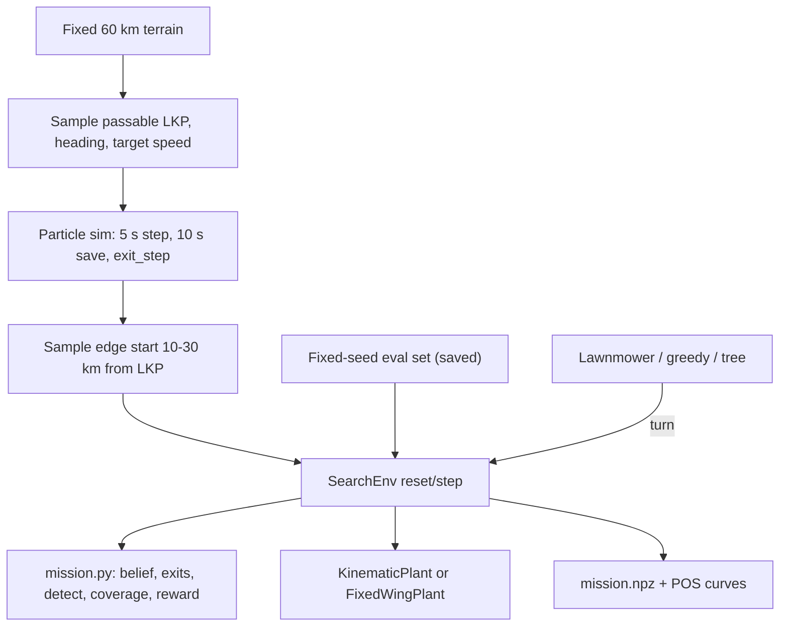

# RL vs Lawnmower: 0~4단계 계획

## 목표

같은 비행거리(100 km, 배터리 대리지표) 조건에서 RL이 고른 turn으로 비행하면 lawnmower보다 누적 POS가 높아질 수 있음을 보인다. 이번 계획은 RL을 학습시킬 바탕까지만 다룬다. 무작위 시나리오 생성기, 임무와 기체를 나눈 환경, lawnmower 베이스라인, 고정익 동역학 모델까지다.

## 확정한 결정

- **기존 파일:** 루트의 기존 파일은 참고용으로 그대로 둔다. 바꿔야 하는 부분은 `rl_search/`로 복사(fork)해서 수정한다. 수정한 뒤에는 기존 플래너 결과와 비교한다.
- **맵과 시간:** 지형은 seed 하나로 만든 60 km × 60 km 절차적 지형 하나를 고정해서 쓴다. t = 0은 LKP 관측 시각이면서 UAV 출발 시각이다.
- **UAV:** 속도는 120 km/h(33.3 m/s)이고, 비행 한도는 100 km(3000 s, 50분)다. 결정 간격 `dt`는 2 s이고, 한 스텝은 67 m로 footprint 길이 83 m보다 짧다. 시작 heading은 LKP를 향한다.
- **출발점:** 언제나 60 km 맵의 가장자리(네 변)에서 출발한다. 출발 위치에 따른 커리큘럼은 쓰지 않는다.
- **시나리오 공급:** 학습용 시나리오는 미리 저장해 두지 않고 매번 새로 만든다. 기본은 reset마다 타겟과 UAV 출발점을 모두 새로 뽑는 것이다. 입자 궤적은 UAV 행동과 무관하므로(UAV는 가중치만 바꾼다), 너무 느리면 같은 궤적을 출발점만 바꿔 재사용하거나 시나리오 뱅크를 쓰는 쪽으로 바꿀 수 있다. 방법 간 공정한 비교를 위해 평가용 시나리오만 고정 seed로 만들어 저장한다.
- **타겟:** LKP는 UAV 출발점에서 10~30 km 떨어진 곳이다. 시나리오마다 속도를 20~40 km/h에서 균등하게 뽑는다. heading은 [0°, 360°)에서 균등하게 뽑고, 불확실성은 1σ = 25°다. 이동 모델은 당분간 기존 침투자 모델을 쓴다. 나중에 차량용 포장/비포장 도로 모델로 바꿀 수 있게 자리를 만들어 둔다.
- **입자:** 5000개다. 시뮬레이션 간격은 5 s, 저장 간격은 10 s, 시뮬레이션 길이는 60분(비행 50분 + 여유 10분)이다. UAV 쪽에서는 기존 `ParticleBelief.positions`의 선형 보간으로 2 s 시각의 위치를 구한다.
- **맵 밖으로 나간 입자:** 맵 경계를 넘는 순간부터 그 입자는 더 이상 고려하지 않는다. 탐지 대상에서도, 플래너가 보는 확률에서도 빠진다. 그 질량은 "놓친 확률"로 따로 집계하고 POS에는 넣지 않는다. 따라서 시나리오마다 얻을 수 있는 최대 POS는 1 - (이탈 질량)이다.
- **카메라:** 기체에 장착한 안정화 짐벌이 롤과 피치를 상쇄해서 카메라는 항상 수직 아래를 본다. 짐벌 롤 범위는 ±45°로 가정하고, 롤 한도 35°보다 크므로 선회 중에도 footprint는 기체 바로 아래, heading 방향으로 정렬된 83 × 115 m 직사각형이다. 나중에 전방 경사나 능동 짐벌로 바꿀 수 있게 footprint 계산을 센서 모델 하나로 분리한다.

## 전체 흐름



## 0단계: 폴더와 준비 (완료)

```
rl_search/
  README.md             실행 순서
  requirements.txt      numpy, scipy, matplotlib
  terrain.py            절차적 지형 생성: TerrainConfig, Terrain, make_terrain, save/load
  plotting.py           음영 기복 지형 그림
  target.py             fork: create_guidelines, simulate (LKP, heading, 속도를 인자로, 이탈 기록)
  scenario.py           샘플러, ScenarioGenerator, 평가 세트 저장과 불러오기
  mission.py            uav_search.py에서 fork: SearchConfig, ParticleBelief, footprint/POA, detect, Coverage
  plants.py             KinematicPlant, FixedWingPlant
  env.py                SearchEnv
  planners.py           fork한 straight/greedy/tree + lawnmower
  scripts/
    make_terrain.py     지형 1회 생성 -> data/terrain_seed7_60km.npz
    make_scenarios.py   평가 세트 생성, 요약 그림, 분포 히스토그램
    export_scenario.py  시나리오 하나를 기존 simulation_data.npz 형식으로 내보내기
    compare.py          같은 시나리오에서 방법별 POS 곡선 비교
    check_plant.py      고정익 모델 검증 그림
  data/                 생성물 (git 제외)
```

- 지형: 고지대에 길게 이어지는 산맥, 구릉, 고도의 배수망을 따라 생기는 강과 개울, 깊은 분지는 호수이고 얕은 분지는 평야, 큰 강 위 약 5 km 간격의 여울, 높고 경사진 곳에 많은 숲이다. 이동 불가 구역(산 상위 8%, 강, 호수, 32° 이상 경사)은 맵의 약 14%다. 층 이름(`z`, `water`, `fords`, `mountain`, `forest`)은 기존 뷰어와 호환된다. 개울(`stream`)은 그림용이고 이동을 막지 않는다.
- 노면 자리: `surface` 층(0 = 야지, 1 = 비포장, 2 = 포장)이 있고, 지금은 전부 0이다.

## 1단계: 시나리오 생성기

### 샘플링 (타겟 먼저, UAV 출발점은 나중)

- **LKP:** `terr.clearance`가 200 m 이상인 칸(강, 호수, 산, 급경사에서 떨어진 곳) 중에서, 맵 경계에서 1 km 이상 안쪽인 곳을 균등하게 뽑는다. 이 조건을 만족하는 칸 목록에서 바로 뽑으므로 재추출이 없다. 60 km 맵에서는 어떤 LKP든 10~30 km 떨어진 가장자리 점이 항상 있다.
- **UAV 출발점 (에피소드마다):** 맵 둘레(240 km, 모서리 1 km 제외)를 10 m 간격으로 나눈 점들 중 LKP에서 10~30 km 거리인 점을 균등하게 하나 뽑는다. UAV는 지형의 영향을 받지 않으므로 출발점이 산이나 강 위여도 된다. 시작 heading은 LKP를 향한다.
- **재사용 (선택):** 설정값 `reuse`(기본 1)만큼 같은 타겟 시뮬레이션을 출발점만 새로 뽑아 쓴다. 기본값 1은 매 에피소드 완전히 새 시나리오다.
- **타겟 속도:** v_t를 U[20, 40] km/h로 뽑는다. `speed_mean = v_t`, `speed_std = 0.1 v_t`로 둔다. 빠른 이동 모드를 포함한 순간 속도는 40 km/h에서 자른다.
- **이동 모델 자리:** `target.py`의 한 스텝 이동을 `move_model` 함수 하나로 분리하고, 이름으로 고르게 한다(지금은 `infiltrator`만). 속도는 노면별 표(지금은 야지 값 하나)에서 읽는다.
- **유도선:** 도달 거리는 `v_max * 60분`(최대 40 km)으로 잡고 60 km 맵에서 자른다. 간격(stride)은 60 m로 둔다. 기존 유도선은 맵 경계에서 멈추는데, 이번에는 경계에서 멈추지 않고 맵 밖으로 나갈 수 있게 한다(입자가 경계에 쌓이지 않도록).

### 다른 검사를 빼도 되는 이유

UAV(33.3 m/s)가 가장 빠른 타겟(11.1 m/s)보다 3배 빨라서, 가장 불리한 경우에도 따라잡을 수 있다.

- 가장 불리한 경우: LKP가 30 km 떨어져 있고, 타겟이 40 km/h로 정반대 방향으로 도주한다.
- 추격 시간은 30,000 / (33.3 − 11.1) ≈ 1350 s(22.5분)로, 비행 한도의 45%다. 그래도 55%(약 55 km)가 남는다.

그래서 기존 계획의 "도달 가능 질량"과 "추격 후 남는 비행" 검사는 항상 통과하므로 기각 조건에서 뺀다. 계산은 싸므로 시나리오 지표로만 기록한다. "입자가 맵 안에 있음" 검사는 위의 "맵 밖으로 나간 입자" 규칙으로 대체한다.

### 맵 밖으로 나간 입자 (exit_step)

- `target.py`에서 입자의 다음 위치가 맵 밖이면, 그 스텝을 이탈 시각으로 기록하고 이후 위치를 맵 밖 마지막 위치로 고정한다.
- 저장: 입자마다 `exit_step`(int16, 저장 간격 기준 인덱스, 이탈하지 않으면 -1)을 함께 저장한다. 크기는 입자 5000개에 10 KB다.
- 이탈 시각 사이의 보간: 저장 간격 k와 k+1 사이에서 이탈한 입자는 k+1부터 제외한다.

### 생성 비용과 공급 방식

- 측정값(맥): 기존 `create_guidelines` + `simulate`로 입자 5000개, 5 s 간격 720 스텝을 돌리면 유도선 0.2 s, 입자 시뮬레이션 7.4 s다. 에피소드 하나(2 s 간격 1500 스텝)의 탐지 계산은 약 1 s로 예상된다.
- 학습용 `ScenarioGenerator`는 reset마다 새 시나리오를 만든다(에피소드당 약 8.4 s, 코어 하나당 초당 약 180 스텝으로 추정). 병렬 환경(우분투에서 여러 프로세스)은 각자 생성기를 가진다. 생성기 하나의 메모리는 시나리오 하나(약 14 MB)다.
- 생성 시간과 환경 스텝 시간을 따로 기록해서 우분투에서 초당 스텝을 잰다. 생성이 병목이면 다음 순서로 검토한다: `reuse` 올리기(4면 약 2.9 s), 입자 반복문 최적화나 입자 수 줄이기, 미리 만든 시나리오 뱅크.

### 평가 세트 (저장)

- 평가용만 고정 seed로 만들어 저장한다. 맥에서는 5개, 우분투에서는 50개다. 시나리오 하나는 타겟 시뮬레이션 1회 + 출발점 1개다.
- 시나리오 하나 = `track.npy`(361 × 5000 × 2, float32, 약 14 MB) + `exit_step.npy` + `meta.json`이다. `meta.json`에는 출발 자세, LKP, heading, v_t, seed, 지표(50분 시점 이탈 질량, 추격 시간 t*, 도달 가능 질량)를 넣는다. 지형은 공유 파일 하나를 참조한다. 우분투 50개는 약 0.7 GB다.
- 불러올 때는 `np.load(..., mmap_mode="r")`로 연다.
- `make_scenarios.py`는 평가 세트를 만들고, 출발점, LKP, 최종 입자 구름을 겹쳐 그린 요약 그림을 저장한다. 또 생성기로 100개를 만들어 이탈 질량과 추격 시간 분포 히스토그램을 그린다(분포 확인용, 저장하지 않음).

### 확인

- `export_scenario.py`로 시나리오 하나를 기존 `simulation_data.npz` 형식으로 내보낸다. 내용은 지형 배열(`terrain`, `axis`, `forbidden`, `mountain`, `water`, `fords`, `forest`), `track`, `lkp`, `heading_deg`, `dt_s = 10`이다.
- 기존 `uav_search.py`는 이탈 입자를 모른다. 그래서 이 확인용 내보내기에서는 이탈 입자를 맵 밖 마지막 위치에 그대로 둔다. footprint가 맵 밖 입자를 덮는 일은 드물어서 결과 차이는 작다. 정확한 처리는 2단계 `mission.py`에서 한다.
- 기존 코드를 수정하지 않고 돌린다. `--max-turn`은 4단계 고정익 한계와 같은 값(23.5°/스텝)을 쓴다.

```bash
python uav_search.py rl_search/data/export/<scenario> --plan greedy \
  --launch-delay 0 --flight 50 --speed 33.33 --dt 2 --max-turn 23.5 \
  --start <X> <Y> --start-heading <H>
python mission_viewer.py rl_search/data/export/<scenario>/search_greedy
```

- 완료 기준:
  - 생성기가 같은 seed에서 같은 시나리오를 만들고(재현성), 평가 세트가 저장되며, 이탈 질량과 추격 시간 분포가 그림으로 나온다.
  - 내보낸 시나리오에서 기존 greedy가 경고 없이 돌아가고, POS 곡선과 궤적을 뷰어로 볼 수 있다.
  - 시나리오 하나 생성 시간과 greedy 한 판의 실행 시간을 기록한다.
  - 입자 밀도를 확인한다. UAV가 도착한 시각에 가장 좋은 footprint의 POA를 기록하고, 1e-3 미만이면 KDE 대역폭을 150 m에서 300 m로 올려 다시 확인한다.

## 2단계: 임무 계산부와 기체 처리부 분리

- **`mission.py` (임무 계산부):** `ParticleBelief`, `footprint_probs`, `poa`, `detect`, `Coverage`를 fork한다. 기체 종류는 모른다. 스텝 보상은 그 스텝의 POS 증가량(`detect`의 반환값)이다.
- **이탈 입자 처리:** `ParticleBelief`가 `exit_step`을 받는다. 시각 t에 이탈한 입자는 `active(t)` 마스크에서 빠지고, `detect`, `poa`, 플래너의 입자 질량 계산 모두 이 마스크를 쓴다. 이탈하는 순간 그 입자의 남은 가중치를 `escaped` 질량으로 옮긴다. 그래서 `1 = POS + 남은 질량 + escaped`가 항상 성립한다. 회귀 확인을 위해 `use_exits=False`이면 기존과 똑같이 동작한다.
- **센서 모델:** `detect`, `poa`, `Coverage.update`가 footprint를 직접 계산하지 않고 `NadirSensor.footprint(pose, attitude) -> (cx, cy, yaw, along, cross, pod)`를 거치게 한다. `NadirSensor`는 attitude를 무시하고 지금과 같은 직사각형을 돌려준다. 나중에 전방 경사 센서는 중심을 `고도 × tan(경사각)`만큼 앞으로 옮기고 크기와 POD를 바꾸는 식으로 같은 인터페이스에 추가한다. 능동 짐벌은 env 행동 벡터에 짐벌 각도를 추가하는 방식으로 확장한다. 그래서 `env.step`은 처음부터 행동을 배열로 받고, 지금은 첫 원소(turn)만 쓴다.
- **`plants.py` (기체 처리부):** 공통 인터페이스는 `reset(pose)`, `step(turn_cmd) -> pose`, `max_turn`이다. 첫 구현인 `KinematicPlant`는 기존 `Planner.advance`와 같다(yaw += turn, 고정 step).
- **`env.py`:**
  - `reset(seed=None, options=None)`는 `options["scenario"]`가 있으면 그 시나리오(평가 세트)를, 없으면 `ScenarioGenerator`에서 다음 시나리오를 받아 belief, coverage, plant를 초기화하고 관측과 정보를 돌려준다.
  - `step(turn)`은 turn을 `[-max_turn, max_turn]`에서 자르고, plant를 한 스텝 진행한 뒤 이탈 갱신, `detect`, 커버리지 갱신을 하고, (관측, 보상, 종료, 잘림, 정보)를 돌려준다. 정보에는 POS, 남은 질량, escaped 질량을 넣는다.
  - 비행거리가 100 km에 도달하면 잘림(truncated)이다. 60 km 맵을 벗어나면 종료(terminated)다.
  - 관측은 이번 범위에서는 자세와 남은 비행시간만 둔다. 정책용 관측 설계는 RL 단계에서 정한다.
  - 로그는 기존 `mission.npz` 형식(`t_s`, `poses`, `plan`, `weights`, `gain`, `pos_cum`, `fallback`, `searched_km2`)에 `escaped`를 더해 저장한다. [`mission_viewer.py`](mission_viewer.py)에서 바로 볼 수 있다.
- **`planners.py`:** 기존 straight, greedy, tree를 fork하고, env에서 turn을 받아 가는 형태로 감싼다. 플래너는 계속 belief를 직접 보고 계획한다.
- 완료 기준: 내보낸 시나리오에서 `use_exits=False`, `KinematicPlant` + greedy의 POS 곡선이 1단계의 기존 `uav_search.py` 결과와 같다(같은 cfg, 수치 오차 수준). `use_exits=True`일 때 질량 보존식이 매 스텝 성립한다.
- 결과 (`scripts/check_env.py`): greedy와 tree 모두 기존 결과와 POS, 자세, 탐색 면적이 완전히 같다(차이 0). 질량 보존 오차는 1e-9 미만이다. 환경만 돌리면 약 710 스텝/s(맥, 코어 하나)이고, greedy 한 판은 약 6 s, tree 한 판은 약 46 s다.
- 발견: greedy는 초기 조건에 매우 민감하다. s1000001에서 시작 heading을 0.01° 바꾸면 최종 POS가 0.36에서 0.002로 바뀐다. 3단계 비교는 시나리오 하나가 아니라 평가 세트 전체의 평균과 분산으로 봐야 한다.

## 3단계: lawnmower 베이스라인

- **이동 구간:** 입자 질량 중심 c(t)를 향해 직선으로 비행하다가, 탐색 영역 안에 들어가면 왕복을 시작한다.
- **탐색 영역:** 도착 시각부터 비행 종료까지 맵 안에 남아 있는 입자 위치를 모두 합쳐, 그중 80%를 담는 가장 작은 영역(HDR)을 구한다. 그 영역을 감싸는 사각형을 타겟 heading 방향으로 정렬하고 맵 안으로 자른다. 영역은 도착 시점에 고정한다(표준 고정 패턴).
- **왕복 패턴:** 줄 간격은 footprint 폭 115 m다. 선회 지름(2R, 롤 35°에서 약 324 m)이 줄 간격보다 커서, 바로 옆 줄로 돌아오지 않고 k = ceil(2R / 115) = 3줄씩 건너뛰는 순서로 비행한다. 영역을 다 덮으면 처음부터 반복한다.
- **조종:** 웨이포인트까지 heading 오차를 줄이는 단순 유도 법칙으로 turn을 계산하고, plant의 `max_turn`으로 자른다. 그래서 같은 plant 위에서 RL과 같은 조건으로 비교된다.
- **비교 스크립트 `compare.py`:** 같은 평가 세트에서 straight, lawnmower, greedy, tree를 돌린다. 지표는 시간에 따른 POS, 비행거리에 따른 POS, 최종 POS, 최대 가능 POS(1 - escaped) 대비 비율, 탐색 면적(km²), 실행 시간이다. 시나리오별 그림과 평균 및 분산 표를 저장한다.
- 완료 기준: 평가 세트에서 네 방법의 비교 그림과 표가 나온다.

## 4단계: 고정익 동역학 모델

- **상태:** (x, y, ψ, φ). ψ는 heading, φ는 롤 각도다. 속도 V = 33.3 m/s는 고정이다.
- **입력 변환:** 행동은 지금처럼 결정 간격당 turn δ다. 목표 선회율 `r = δ / dt`를 롤 목표값 `φ_cmd = atan(r V / g)`로 바꾸고, `[-φ_max, φ_max]`에서 자른다.
- **동역학 (내부 적분 0.1 s, 결정 간격 2 s당 20 회):**
  - 롤 응답은 1차 지연이다: `dφ/dt = (φ_cmd - φ) / τ`. 롤 속도는 `p_max`로 제한한다.
  - 선회는 균형 선회다: `dψ/dt = g tan(φ) / V`.
  - 위치는 `dx/dt = V cos ψ`, `dy/dt = V sin ψ`다.
- **초기값 (PX4 기본값 근처, 로드맵 4번에서 비행 기록으로 다시 맞춤):**
  - φ_max = 35° (`FW_R_LIM` 참고). 선회 반경은 약 162 m, 최대 선회율은 약 11.8°/s다.
  - τ = 0.5 s (`FW_R_TC` 0.4 s에 지연 여유를 더함).
  - p_max = 60°/s (`FW_R_RMAX` 참고).
  - `max_turn = g tan(φ_max) / V * dt`, 약 23.5°/스텝이다. 이 값을 모든 방법과 1단계 확인의 `--max-turn`에 똑같이 쓴다.
- **환경 연결:** `SearchEnv`에서 plant만 바꿔 끼운다. 탐지는 결정 간격마다 실제 도착 자세(지연이 반영된 위치와 heading)로 계산한다. 롤 상태 φ는 정보(info)와 로그에 남기고 센서 모델에 attitude로 넘긴다. 짐벌이 롤을 상쇄하므로 `NadirSensor`에서는 쓰지 않지만, 짐벌 범위(±45°)를 넘는 롤이 나오면 경고한다.
- **`check_plant.py` 검증:**
  - 계단 입력 응답: φ_cmd를 계단으로 줬을 때 φ(t)가 τ와 p_max대로 움직이는지 본다.
  - 일정 선회: 정상 상태의 선회 반경이 `V^2 / (g tan φ_max)`와 1% 안에서 맞는지 본다.
  - 같은 turn 명령열(직진, 최대 선회, 좌우 교대)에서 `KinematicPlant`와 `FixedWingPlant`의 궤적을 겹쳐 그린다.
- 완료 기준: 검증 그림 세 장이 나오고, 3단계 비교를 `FixedWingPlant` 위에서 다시 돌려 lawnmower, greedy, tree의 POS가 즉시 반응 모델 대비 얼마나 줄었는지 표로 남긴다.

## 이번 범위에서 뺀 것

- RL 학습(관측 설계, 보상 조정, PPO 학습 일정). 4단계 결과를 보고 따로 계획한다. 출발 위치 커리큘럼은 쓰지 않기로 했다.
- 포장/비포장 도로 지형과 차량 이동 모델. 이번에는 `surface` 층과 `move_model` 자리만 만든다.
- PX4/Gazebo 연결, 비행 기록으로 모델 값 맞추기, Gazebo 검증, 여러 대 UAV.
